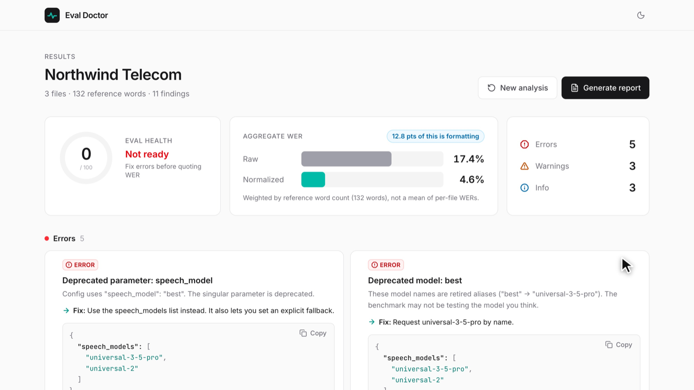

# Eval Doctor

Checks a customer's speech-to-text benchmark for setup mistakes before anyone quotes a WER number. It helps customers run a fair eval on AssemblyAI.

You give it audio files, truth transcripts and the request config. It:

1. Lints the config for known AssemblyAI mistakes. This needs no API call.
2. Checks the audio and truth files for problems that make the benchmark unfair.
3. Transcribes the audio and reports raw WER next to normalized WER.
4. Writes a short customer report you can paste into Slack.



## Run it

```bash
cp .env.example .env        # add ASSEMBLYAI_API_KEY (optional, see below)
docker compose up           # http://localhost:5173
```

or without Docker (Python 3.11+, Node 20+, ffmpeg):

```bash
make install
make dev                    # backend :5001, frontend :5173
make test
```

Click **Load demo customer**, then **Analyze**.

**Mock mode.** If no API key is set, the app uses the saved AssemblyAI responses in `demo/cached/` and shows a "Mock mode" badge. To refresh them, run `make cache` with a key. Real responses are also cached in `backend/.cache/{sha256(audio + config)}.json`, so a re-run is instant and costs no credits.

## Checks

| Group | id | Severity |
|---|---|---|
| Config | `deprecated_param` (`speech_model` singular) | error |
| | `deprecated_model` (`best`, `nano`, `slam-1`) | error |
| | `prompt_and_keyterms` (mutually exclusive on Universal-3.5 Pro async) | error |
| | `silent_fallback_risk` (language outside Universal-3.5 Pro's 18, no explicit `universal-2`) | warning |
| | `no_language_setting` | info |
| | `stream_sample_rate_mismatch`, `stream_encoding_mismatch` | error |
| Audio | `telephony_audio` (8 kHz), `stereo_dual_channel` | info |
| | `mostly_silence`, `clipping` | warning |
| Truth | `missing_truth`, `orphan_truth`, `truth_has_timestamps`, `truth_wrong_file` | error |
| | `truth_has_speaker_labels` | warning |
| | `truth_casing_punct` | info |
| Post-run | `fallback_happened` (`speech_model_used` differs from the requested model) | warning |
| | `normalization_gap` (raw minus normalized WER > 5 pts) | info |

Each check is a small pure function in `backend/checks/` and has a test in `backend/tests/`.

**Scoring.** Raw WER only lowercases the text. Normalized WER uses Whisper's `EnglishTextNormalizer` (or `BasicTextNormalizer` for other languages), applied the same way to truth and transcript. The aggregate WER is total errors divided by total reference words, not the mean of per-file WERs. Files run with the corrected config, and truth files are stripped of timestamps and speaker labels so the score reflects recognition errors only.

## Changes from the original brief (AssemblyAI docs, Nov 2026)

- The current pre-recorded model is `universal-3-5-pro`. `best` and `slam-1` map to it, and `nano` maps to `universal-2`.
- Universal-3.5 Pro supports 18 languages, including Spanish. The demo uses a Polish clip for the silent fallback case.

## Demo video

`demo-video/` holds a reshoot project. With the app running, `reshoot run demo-video/reshoot.toml` re-records the 58 s demo. The last render is `demo-video/eval-doctor-demo.mp4`.
